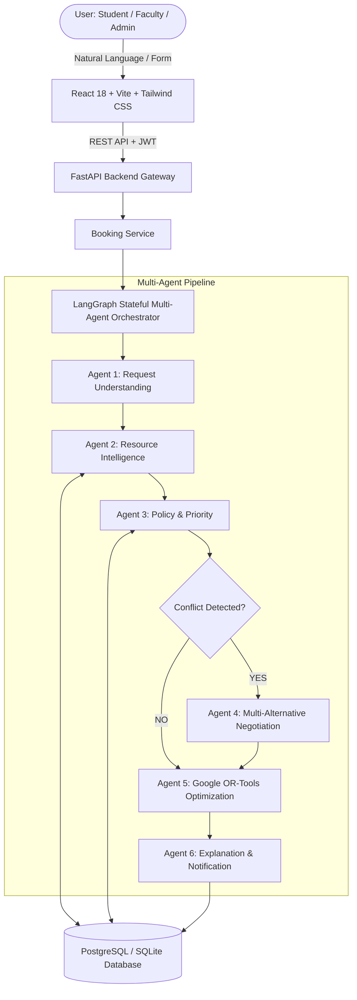

# CampusFlow – Agentic AI Framework for Autonomous University Resource Negotiation & Scheduling

CampusFlow is an Agentic AI-based university resource management and scheduling platform. It replaces traditional First-Come-First-Serve (FCFS) allocation with an intelligent multi-agent pipeline: **Understand → Check → Prioritize → Negotiate → Optimize → Explain**.

---

## 1. Project Overview & Problem Statement
Universities manage scarce, shared resources such as auditoriums, seminar halls, laboratories, conference rooms, smart classrooms, and campus buses. Traditional scheduling systems rely on First-Come-First-Serve (FCFS) booking, which causes:
- Resource underutilization and hoarding.
- Rejection of mission-critical institutional activities (e.g. campus recruitment drives and university examinations) by trivial or early-submitted club meetings.
- Lack of negotiation flexibility when conflicts arise.
- Opaque, unexplained rejection decisions.

### Proposed Solution
CampusFlow introduces a collaborative multi-agent architecture where six modular AI agents collaborate statefully:
1. **Understand**: Converts natural language requests into validated structured models.
2. **Check**: Real-time availability, physical capacity, equipment, operating hours, and maintenance inspection.
3. **Prioritize**: Dynamic institutional priority evaluation via database-driven policies.
4. **Negotiate**: Autonomous synthesis of alternative allocation plans (venue substitution, time shifting, priority preemption).
5. **Optimize**: Mathematical constraint-solving and multi-factor objective scoring using **Google OR-Tools CP-SAT**.
6. **Explain**: Generates transparent, human-readable explanations and structured decision factors.

---

## 2. System Architecture



---

## 3. The Six AI Agents

| Agent | Purpose | Module | Core Logic |
| :--- | :--- | :--- | :--- |
| **1. Request Understanding Agent** | Natural Language Parsing | `app/agents/request_understanding/` | LLM + strict Pydantic validation + heuristic regex fallback |
| **2. Resource Intelligence Agent** | Facility & Overlap Analysis | `app/agents/resource_intelligence/` | Temporal interval overlap, capacity ratio, equipment matching |
| **3. Policy & Priority Agent** | Institutional Rule Checking | `app/agents/policy_priority/` | Reads database policies; assigns VERY_HIGH, HIGH, MEDIUM, LOW |
| **4. Negotiation Agent** | Alternative Synthesis | `app/agents/negotiation/` | Alternative venues, time shifts within flexibility, priority swaps |
| **5. Optimization Agent** | Deterministic Solver | `app/agents/optimization/` | **Google OR-Tools CP-SAT** with configurable weighted scoring |
| **6. Explanation & Notification Agent** | Explainable AI & Sync | `app/agents/explanation_notification/` | Decision factors, calendar sync, notifications, audit trail |

---

## 4. Technology Stack

- **Frontend**: React 18, Vite, TypeScript, Tailwind CSS, Lucide Icons, Recharts, React Router v6, Axios.
- **Backend**: Python 3.11+, FastAPI, Pydantic v2, SQLAlchemy 2.0, Uvicorn, LangGraph, Google OR-Tools, PyJWT.
- **Optimization**: Google OR-Tools CP-SAT Solver.
- **Database**: PostgreSQL (Production/Docker) with automatic SQLite local fallback (`sqlite:///./campusflow.db`).
- **Containerization**: Docker, Docker Compose, Nginx.

---

## 5. Demo Accounts & Credentials

The seed data script automatically creates demo accounts for all five user roles with password `Password123!`:

| Role | Email | Password | Access Scope |
| :--- | :--- | :--- | :--- |
| **Student** | `student@campusflow.edu` | `Password123!` | Create bookings, cancel own, view notifications |
| **Faculty** | `faculty@campusflow.edu` | `Password123!` | Create bookings, view own department bookings |
| **Department Admin** | `deptadmin@campusflow.edu` | `Password123!` | Oversee department requests & allocations |
| **Resource Manager** | `manager@campusflow.edu` | `Password123!` | Manage venues, maintenance, perform overrides |
| **System Administrator** | `admin@campusflow.edu` | `Password123!` | Full control: users, policies, audit logs, analytics |

*(Quick 1-Click login buttons for all these roles are available directly on the Login screen)*

---

## 6. Installation & Running Locally

### Prerequisites
- Python 3.10+ (Python 3.11 - 3.13 tested)
- Node.js 18+ and npm

### Step 1: Backend Setup
```bash
cd backend
python -m venv venv

# Activate virtual environment:
# On Windows:
venv\Scripts\activate
# On Linux/macOS:
source venv/bin/activate

pip install -r requirements.txt

# Seed realistic university resources, users, and conflicting bookings:
python seed/seed_data.py

# Start FastAPI server:
uvicorn app.main:app --reload --port 8000
```
*The API is now running at `http://localhost:8000`. Interactive docs are at `http://localhost:8000/api/docs`.*

### Step 2: Frontend Setup
```bash
cd ../frontend
npm install
npm run dev
```
*The web application is now accessible at `http://localhost:5173`.*

---

## 7. Running with Docker Compose

To spin up the complete containerized stack (PostgreSQL, FastAPI backend, and Nginx React frontend):

```bash
docker compose up --build
```
- Frontend UI: `http://localhost:3000`
- Backend API: `http://localhost:8000`

---

## 8. End-to-End Demonstration Scenario

User enters the natural language request:
> *"I need Seminar Hall A tomorrow from 10 AM to 1 PM for 250 students for a CSE technical symposium. We need a projector and microphone. We can shift the event by one hour."*

### System Execution Steps:
1. **Request Understanding Agent**: Extracts event parameters (`Seminar Hall A`, `250 students`, `10:00 - 13:00`, `flexibility: ±60 mins`, `equipment: projector, mic`).
2. **Resource Intelligence Agent**: Detects conflict with existing "Placement Drive" in Seminar Hall A (`10:00 - 12:00`).
3. **Policy & Priority Agent**: Evaluates university policies; assigns `HIGH` priority.
4. **Negotiation Agent**: Generates 3 candidate alternatives (Reallocate to Main Auditorium, Reallocate to Seminar Hall B, or shift time slot).
5. **Optimization Agent (Google OR-Tools)**: Solves the constraint model and selects optimal plan with highest multi-factor score.
6. **Explanation & Notification Agent**: Dispatches in-app notification, updates campus calendar, and records structured decision factors into `DECISION_LOGS`.

You can also run this verification directly from terminal:
```bash
cd backend
python verify_demo.py
```

---

## 9. University Performance Metrics (Formulas)

CampusFlow evaluates scheduling efficiency using eight formal mathematical metrics displayed on the Analytics dashboard:

1. $\text{Resource Utilization} = \frac{\text{Allocated Resource Hours}}{\text{Total Available Resource Hours}} \times 100$
2. $\text{Conflict Resolution Rate} = \frac{\text{Resolved Conflicts}}{\text{Total Conflicts}} \times 100$
3. $\text{Average Allocation Time} = \frac{\text{Total Processing Time}}{\text{Number of Requests}}$
4. $\text{Policy Compliance Rate} = \frac{\text{Policy-Compliant Allocations}}{\text{Total Allocations}} \times 100$
5. $\text{Fairness Index} = \frac{\text{Satisfied Requests}}{\text{Total Requests}} \times 100$
6. $\text{User Satisfaction Score} = \frac{\sum \text{User Ratings}}{\text{Number of Users}}$
7. $\text{Manual Intervention Rate} = \frac{\text{Manual Overrides}}{\text{Total Requests}} \times 100$
8. $\text{Scheduling Accuracy} = \frac{\text{Successful Allocations}}{\text{Total Requests}} \times 100$

---

## 10. Testing

### Run Backend Tests (pytest):
```bash
cd backend
pytest tests/ -v
```
*(All 12 unit and integration tests verify each agent, OR-Tools optimization, and full LangGraph workflow)*

### Run Frontend Tests (vitest):
```bash
cd frontend
npm run test
```

---

## 11. Security & Compliance
- Passwords hashed using PBKDF2-SHA256 with cryptographically random salts.
- JWT Bearer tokens with expiration and role payload.
- No external LLM API key required: deterministic mock provider runs natively.
- Full audit trail recorded in `AUDIT_LOGS` on any administrative override.
