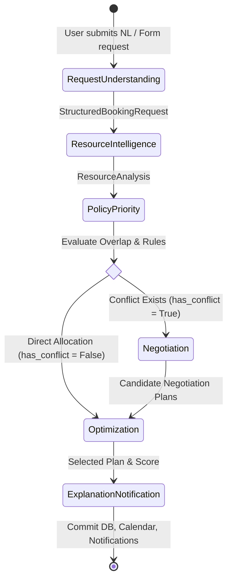

# Multi-Agent Workflow & LangGraph State Machine

CampusFlow is powered by six specialized agents coordinated in a stateful sequential pipeline with dynamic branching.

---

## The Six Autonomous Agents

### 1. Request Understanding Agent
- **Module**: `backend/app/agents/request_understanding/`
- **Input**: Raw unstructured natural language prompt or form input.
- **Output**: Validated `StructuredBookingRequest` Pydantic model.
- **Mechanism**: LLM provider with fallback deterministic regular-expression & entity parser. Never creates records without validating against backend schemas.

### 2. Resource Intelligence Agent
- **Module**: `backend/app/agents/resource_intelligence/`
- **Input**: `StructuredBookingRequest`.
- **Output**: `ResourceAnalysisResult` with availability flags, exact overlap durations, and ranked viable alternative resources.
- **Checks**: Time overlap, physical capacity, operating hours, maintenance windows, and equipment sufficiency.

### 3. Policy & Priority Agent
- **Module**: `backend/app/agents/policy_priority/`
- **Input**: `StructuredBookingRequest` + `ResourceAnalysisResult`.
- **Output**: `PolicyPriorityResult` (`policy_compliant`, `priority`: `VERY_HIGH` | `HIGH` | `MEDIUM` | `LOW`, `applied_rules`, `violations`).
- **Mechanism**: Dynamic rule evaluation querying the `policies` table (Placement precedence, Exam priority, Operating hours, Capacity enforcement, Specialized lab access).

### 4. Negotiation Agent
- **Module**: `backend/app/agents/negotiation/`
- **Input**: Detected conflicts + policy results + user flexibility.
- **Output**: `CandidateNegotiationPlan` list (`PLAN_1`, `PLAN_2`, `PLAN_3`, ...).
- **Strategies**:
  1. *Resource Alternative*: Reallocate to a compatible resource (e.g. Seminar Hall B).
  2. *Time Shift*: Shift timing within user's declared flexibility window (e.g. ±60 minutes).
  3. *Priority Preemption Swap*: If incoming event has higher priority, relocate lower priority event.

### 5. Optimization Agent
- **Module**: `backend/app/agents/optimization/`
- **Input**: Candidate plans + multi-factor scoring weights.
- **Output**: Optimal plan selection with score and breakdown.
- **Engine**: **Google OR-Tools CP-SAT Solver** with objective function:
  $$\text{Score} = w_{\text{priority}} P + w_{\text{res}} R + w_{\text{time}} T + w_{\text{equip}} E + w_{\text{util}} U + w_{\text{fair}} F - w_{\text{pen}} C$$

### 6. Explanation & Notification Agent
- **Module**: `backend/app/agents/explanation_notification/`
- **Input**: Optimal plan + decision context.
- **Output**: Transparent, human-readable explanation, structured decision factors, database update, calendar synchronization, and in-app notifications.
