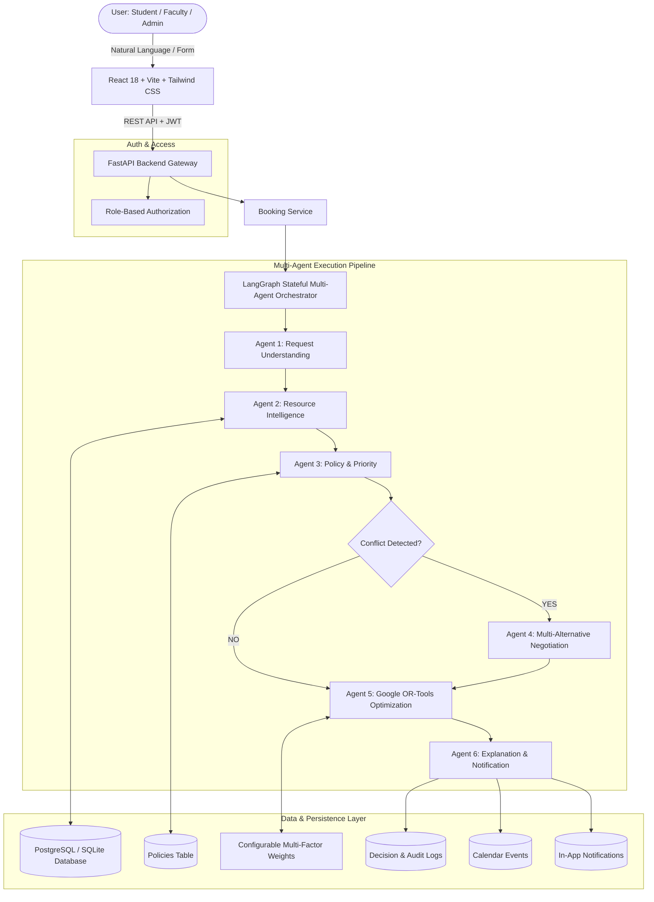

# CampusFlow System Architecture

CampusFlow is an Agentic AI-based university resource management and scheduling platform. It replaces traditional First-Come-First-Serve (FCFS) allocation with an intelligent multi-agent pipeline: **Understand → Check → Prioritize → Negotiate → Optimize → Explain**.

## Architectural Highlights
1. **Separation of Concerns**:
   - The LLM reasons about qualitative aspects and semantic requests.
   - Deterministic constraint layers (Resource Intelligence, Policy Engine, and Google OR-Tools) handle physical capacity, temporal overlaps, and mathematical optimization.
2. **Stateful Orchestration**:
   - Orchestrated via LangGraph `StateGraph(BookingWorkflowState)` with conditional branching based on detected conflicts.
3. **Transparent Explainability**:
   - Every decision stores structured decision factors (priority, capacity, time, equipment, conflict, fairness, final reason) in `DECISION_LOGS`.
4. **Administrative Oversight**:
   - Administrative users can manually override AI allocations with a mandatory audit reason.
