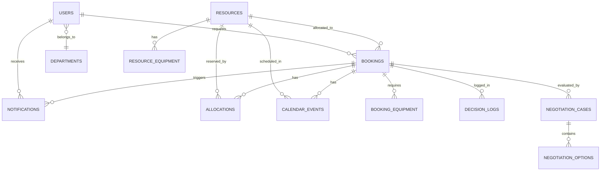

# CampusFlow Database Architecture

CampusFlow uses an ACID-compliant relational schema implemented with SQLAlchemy 2.0. It supports PostgreSQL (production / Docker) and SQLite (zero-dependency local development).

## Entity Details
1. **users**: `id`, `name`, `email`, `password_hash`, `role` (STUDENT, FACULTY, DEPARTMENT_ADMIN, RESOURCE_MANAGER, SYSTEM_ADMIN), `department_id`, `created_at`.
2. **departments**: `id`, `name`, `code`.
3. **resources**: `id`, `name`, `resource_type`, `location`, `capacity`, `status` (ACTIVE, MAINTENANCE, INACTIVE), `operating_start`, `operating_end`, `maintenance_start`, `maintenance_end`, `created_at`.
4. **resource_equipment**: `id`, `resource_id`, `equipment_name`.
5. **bookings**: `id`, `requester_id`, `resource_id`, `event_name`, `event_type`, `resource_type`, `date`, `start_time`, `end_time`, `participant_count`, `status`, `priority`, `time_flexible`, `max_shift_minutes`, `raw_request`, `created_at`, `updated_at`.
6. **booking_equipment**: `id`, `booking_id`, `equipment_name`.
7. **policies**: `id`, `name`, `description`, `rule_type`, `rule_config`, `priority`, `active`.
8. **negotiation_cases**: `id`, `booking_id`, `status`, `conflict_type`, `created_at`, `resolved_at`.
9. **negotiation_options**: `id`, `negotiation_case_id`, `option_data`, `score`, `selected`.
10. **allocations**: `id`, `booking_id`, `resource_id`, `date`, `start_time`, `end_time`, `status`.
11. **decision_logs**: `id`, `booking_id`, `agent_name`, `input_data`, `output_data`, `reasoning`, `created_at`.
12. **notifications**: `id`, `user_id`, `booking_id`, `message`, `type`, `is_read`, `created_at`.
13. **calendar_events**: `id`, `booking_id`, `title`, `date`, `start_time`, `end_time`, `resource_id`.
14. **audit_logs**: `id`, `user_id`, `action`, `entity_type`, `entity_id`, `metadata_json`, `created_at`.
